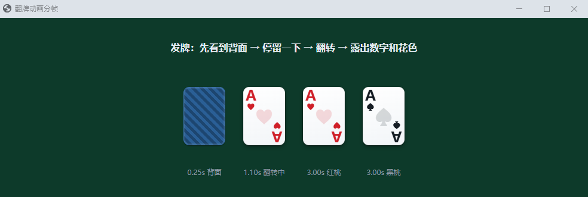
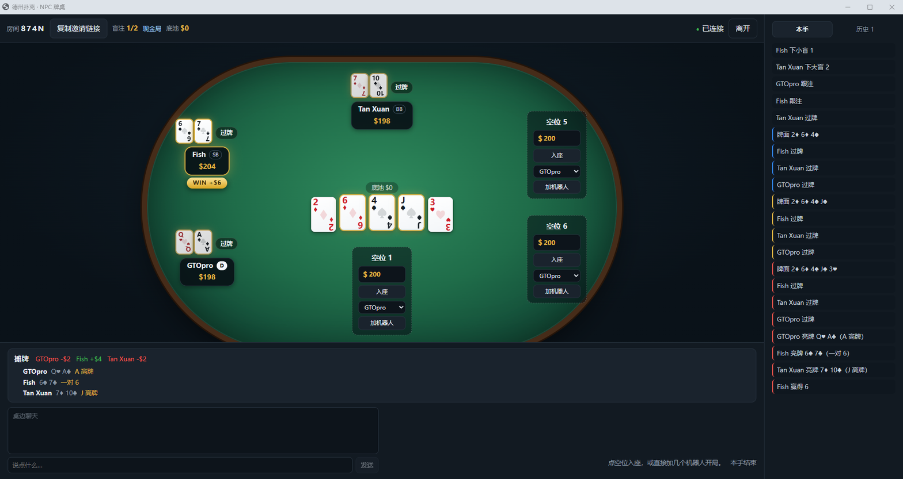
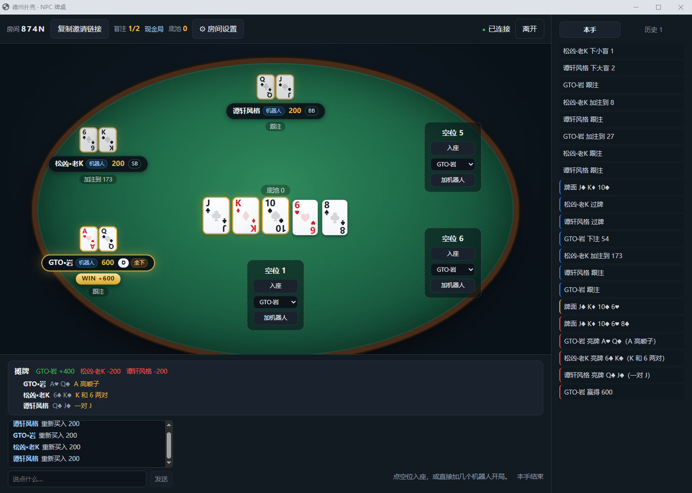
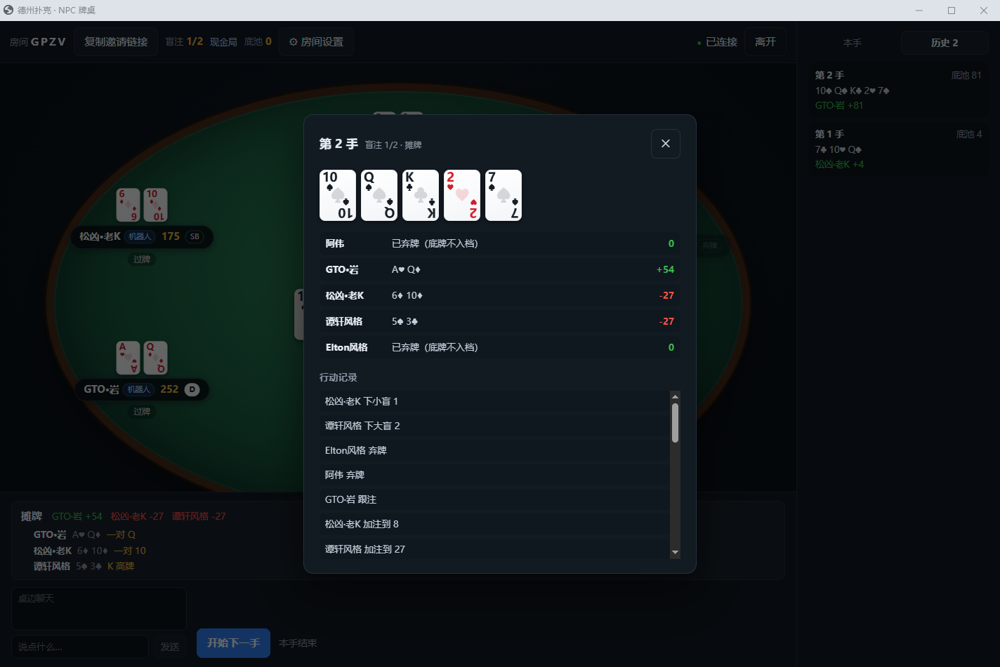
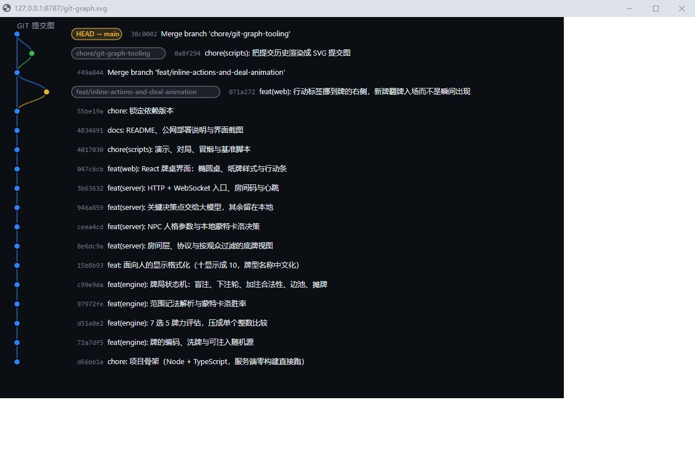

# 德州扑克 · NPC 牌桌

一个可以邀请好友同桌的德州扑克 Web 应用，内置多个**性格不同**的机器人对手。

机器人不是一个"通用 AI"，而是**分层决策**：常规牌由本地蒙特卡洛胜率 + 人格参数决定，
**不花一分钱 token**；只有真正关键的决定才交给大模型。这样既有性格，又能实时响应。

## 快速开始

```bash
npm install          # 安装依赖
npm run build:web    # 构建前端（产出 dist/web）
npm start            # 启动服务
```

然后打开 <http://localhost:8787>，填个昵称，点「创建房间」。

**邀请朋友**：点页面上的「复制邀请链接」，把链接发出去即可。
同一 WiFi 下也可以用启动时打印的局域网地址（`http://192.168.x.x:8787`）。
公网访问见 [docs/deploy.md](docs/deploy.md)。

## 接入你自己的大模型 key

默认**不配 key 也能玩**，机器人只用本地蒙特卡洛 + 人格参数决策，一分钱不花。
配上 key 之后，只有"关键决策点"（大底池、面对全下、河牌大注、边缘跟注）才会问模型。

**推荐做法：把 `.env.example` 复制成 `.env` 再填。** 服务端启动时会自动读它，
不需要任何依赖，也不用管你用的是什么 shell：

```bash
cp .env.example .env      # Windows: copy .env.example .env
# 然后编辑 .env，至少填 DEEPSEEK_API_KEY
npm start
```

`.env` 已经在 `.gitignore` 里，不会被提交。真实的系统环境变量优先级高于 `.env`，
所以临时覆盖依然有效：

```powershell
$env:DEEPSEEK_API_KEY = "sk-你的key"; npm start
```

**接口不绑定 DeepSeek**。`DEEPSEEK_BASE_URL` 指向任何兼容 OpenAI `/chat/completions`
的服务都行——OpenAI、月之暗面、本地 Ollama 都可以，`DEEPSEEK_MODEL` 填对应模型名。
不填就是各家的默认值。

打开大厅页面就能看到当前状态：接了哪个模型、指向哪个地址；**key 本身永远不会发给浏览器**，
前端只知道"配了"还是"没配"。

启动横幅会告诉你大模型是开是关。开启后 `/healthz` 会返回调用次数和 token 消耗：

```json
{"ok":true,"rooms":1,"llm":{"enabled":true,"model":"deepseek-chat",
 "calls":21,"failures":0,"promptTokens":4410,"completionTokens":336}}
```

**实测成本**：4 个机器人打 15 手牌，一共调用 **21 次**、消耗 4,410 prompt + 336 completion tokens
（约每手 1.4 次调用）。按 DeepSeek 的价格算，一晚上几百手牌也就几分钱。

> 模型只做**选择题**：数学层算好胜率和赔率，列出 2–6 个合法候选动作，
> 模型从中挑一个、外加一句桌上发言。它不能发明下注额——
> 回复里出现候选之外的动作会被直接丢弃，退回本地决策。
> 也不允许它算牌：它拿不到别人的底牌。

## 环境变量

| 变量 | 默认 | 说明 |
|---|---|---|
| `DEEPSEEK_API_KEY` | 空 | 配了才启用大模型层 |
| `DEEPSEEK_MODEL` | `deepseek-chat` | 模型名 |
| `DEEPSEEK_BASE_URL` | `https://api.deepseek.com` | 换成兼容端点即可接别家 |
| `DEEPSEEK_TIMEOUT_MS` | `6000` | 超时即放弃，退回本地决策 |
| `ACTION_TIMEOUT_MS` | `60000` | 人类行动限时；超时自动过牌，不能过牌则弃牌。`0` 关闭 |
| `AUTO_START_SECONDS` | `6` | 一手结束后多少秒自动发下一手；`0` = 手动 |
| `BOT_THINK_MIN_MS` / `BOT_THINK_MAX_MS` | `5000` / `10000` | 机器人思考时间区间 |
| `BOT_THINK_MS` | 空 | 设了就覆盖上面两个，区间 = `[值, 值×2]`；`0` = 立即行动 |
| `PORT` / `HOST` | `8787` / `0.0.0.0` | 监听地址 |

## 怎么玩

牌桌是椭圆形的，**你自己的座位永远在正下方**，底牌就摆在你面前；其他玩家分布在桌子的
另外几边，没亮牌时显示牌背。公共牌和底池在正中央，每个座位旁边的金色筹码堆是他这一轮
已经投入的注。

1. 创建房间后，点任意空位的「入座」坐下（默认买入 200）。
2. 空位的下拉框选人格，点「加机器人」，至少凑够 2 人。
3. 点「开始下一手」。

想换座位就点**自己座位上那个「离座」**（会把筹码收回），再点别的空位入座。
一次只能坐一个位子，所以直接点别的位置会被拒绝——提示里也写了该怎么做。
如果牌局正在进行，离座会**等这一手打完**才生效：座位还押在底池里，抽走会算错账。

行动条在右边一格里：上面是加注滑块 + **可以直接输入金额的数字框** + 「半池 / 底池 / 全下」快捷键，
下面是**弃牌 / 过牌 / 跟注 / 加注**一排按钮，全部靠右对齐；左边是**桌边聊天框**。
聊天和行动区**各占底部一半宽度**。轮到你时你的座位会亮起金圈，行动条右边有倒计时。

**牌桌是 400 米跑道那种形状**（直边 + 半圆端），不是椭圆。整张桌子按固定 980×605 排版，
再用 `transform: scale()` 缩放到窗口给的空间，所以全屏时会看到桌子、牌、文字**整体等比放大**，
不会出现"桌子大了但牌还是那么小"。每个玩家的筹码显示在**名字下面一行**，桌上没人叫"机器人"。

**金额一律带 `$`**（筹码、底池、下注、跟注/加注按钮、结算输赢），大数字有千分位。

**下注显示成一对金币**，而且层级压在牌之上，不会被牌面挡住。

**每个玩家的行动标签挂在牌的靠外一侧**（标签是绝对定位的，不会把牌推歪——早先它会把牌挤偏，
结果下注币正好压在牌上）。牌桌按窗口等比缩放，底部聊天和行动区也按 `--ui-scale` 跟着放大，
但只跟到 1.45 倍，免得全屏时按钮变成广告牌。

**发牌有翻牌过程**：新牌先以背面出现、停留一下，再翻过来露出数字和花色。
翻转用的是横向压扁（squash）而不是真正的 `rotateY`——观感一样，但不会让每张牌都常驻一个 3D 渲染上下文。



**每个人自己决定带多少筹码上桌**：空位上有一个 `$____` 输入框，填好再点「入座」；
输光之后行动条上也有同样的输入框，重新买入多少由你定。房间设置里的「起始筹码」现在只是**默认值**，
所以开局后也随时能改，不会动到任何人手里的筹码。买入下限是两个大盲。

**机器人自动重新买入可以关掉**：房间设置 → 「机器人输光后自动重新买入（现金局）」。
关掉之后机器人输光就坐着看戏，不会自己补筹码。

**每手结束时赢家会被标出来**：金色 `WIN +N` 角标（在名牌下面，不挡牌）、名牌变金色，
而**真正组成那手牌的 5 张会被抬起来描金边**——不管它在公共牌里还是赢家手上。
比如公共牌 `J♣ K♦ 10♠ 6♥ 8♣`，赢家是 `A♥ Q♠` 的 A 高顺子，那么只有
`A♥ Q♠ J♣ K♦ 10♠` 这五张会亮，`6♥ 8♣` 保持原样——一眼就能看懂他为什么赢。





## 机器人节奏

默认**每个决策思考 5–10 秒**，让牌局有呼吸感，而不是一瞬间就打完了。想调：

```powershell
# 精确指定区间
$env:BOT_THINK_MIN_MS = "3000"; $env:BOT_THINK_MAX_MS = "6000"

# 或者用对称区间（也支持 0 = 立即行动，调试时很有用）
$env:BOT_THINK_MS = "1500"
```

> 提醒：5–10 秒 × 5 个玩家意味着一手牌可能要好几分钟。想快一点就把区间调到 2–4 秒。

## 自动开局与重新买入

- **自动开局**：一手结束后默认 6 秒自动发下一手，不用每手都点按钮。
  房主可以在设置里改秒数，或设成 `0` 回到手动模式。想立刻开始也可以手动点。
- **现金局里破产的机器人会自动重新买入**，不会因为输光就永远坐在那儿看戏。
- **你自己输光了**，行动条会给你一个「重新买入」按钮。
- **锦标赛没有重新买入**——出局就是出局，机器人也一样。

## 牌局记录

右侧边栏有两个标签页：

- **本手** —— 这一手正在发生的事，按街区分色。
- **历史** —— 每手牌结束后自动归档，点任意一条就能翻看完整记录：
  公共牌、每个人亮出的底牌和输赢、以及逐条行动日志（最多保留最近 100 手）。

归档只保存**当时公开过**的信息。弃牌的玩家在记录里显示「已弃牌（底牌不入档）」，
跟牌桌上一样看不到底牌——否则翻一下历史就能看到别人扔了什么牌，
这套隐藏信息的保证就白做了。




## 房间设置（房主可改）

第一个进房间的人是房主，点顶栏的 **⚙ 房间设置**。当前改不了的项目会直接标出原因。

| 设置 | 说明 | 什么时候能改 |
|---|---|---|
| 座位数 | 2–9 人桌 | 只有桌子空着时 |
| 模式 | 现金局 / 锦标赛 | 第一手牌发出之前 |
| 起始筹码 | 每个新入座玩家的买入 | 第一手牌发出之前 |
| 小盲 / 大盲 | 盲注大小 | 两手牌之间 |
| 行动限时 | 秒，`0` = 关闭；超时自动过牌，不能过牌则弃牌 | 随时 |
| 每多少手升盲 | 锦标赛专用 | 第一手牌发出之前 |
| 每次盲注倍数 | 锦标赛专用，`2` 表示每级翻倍 | 第一手牌发出之前 |

**锦标赛模式**下盲注按设置递增（第 1 级 → 第 2 级 …），顶栏显示当前级别和还有几手升级。
起始筹码不足 20 个大盲会被拒绝——那不是锦标赛，是掷硬币。

## 机器人人格

| 人格 | 风格 |
|---|---|
| GTOpro | 以底池赔率为基准的稳健型，几乎不情绪化 |
| Fish | 入池范围极宽，翻后持续施压 |
| Rock | 只玩强牌，被加注就跑 |
| Tan Xuan | 风格化致敬：大尺度、高压制、河牌超池 |
| Elton | 风格化致敬：小额控池、精准价值下注 |

> 「Tan Xuan」「Elton」是**风格化致敬**，参数按公开打法特征手调，不是真人复刻。
> 公开或商业化之前建议改成虚构角色名——改 `src/server/bots.ts` 里的 `name` 就行。

## 像软件一样打开（没有地址栏的独立窗口）

那两个窗口之所以长得像软件，是因为用的是 Chrome/Edge 的 **`--app` 模式**：
没有标签页、没有地址栏、任务栏里是独立的一项。项目里已经准备好了启动器，**双击即可**：

| 文件 | 作用 |
| --- | --- |
| `launchers\holdem-table.cmd` | 打开牌桌。**服务端没在跑就自动帮你启动**，然后等它就绪再开窗口 |
| `launchers\git-graph.cmd` | 先重新生成提交图，再用独立窗口打开 |

### 做成桌面图标

右键 `.cmd` → **发送到 → 桌面快捷方式**。想换个图标：右键快捷方式 → 属性 → 更改图标。

### 不想用启动器，直接敲命令

Win+R 里粘贴（或任意终端）：

```
chrome --app=http://127.0.0.1:8787
```

Chrome 不在 PATH 里就用全路径：

```powershell
& "$env:ProgramFiles\Google\Chrome\Application\chrome.exe" --app=http://127.0.0.1:8787
```

Edge 同理，把 `chrome.exe` 换成 `msedge.exe` 就行。

### 几个细节

- 窗口是 **16:9 并且居中**的：启动器按屏幕可用区算出「高度 92% 或 16:9 上限」再水平垂直居中
  （2560×1400 的屏幕上是 2290×1288，左右各留 135px）。想换尺寸就改 `launchers/open-app.ps1` 里那两个默认值。
- 启动器用了独立的浏览器配置目录 `.app-profile`，所以这个"应用窗口"跟你日常浏览的
  历史、扩展、登录状态是分开的 —— 更像一个独立软件，也不会把 `127.0.0.1` 塞进你的浏览记录。
- 不想要独立配置，就把 `--user-data-dir` 那段删掉，它会用你平时的 Chrome。
- 牌桌窗口关掉不影响服务端；服务端是启动器用最小化的控制台窗口跑着的，**关掉那个控制台才会停服**。
- 提交图是静态文件，历史变了要重新生成 —— 所以 `git-graph.cmd` 每次都会先跑一遍 `npm run graph`。

## 版本历史与提交图

```bash
npm run graph     # 重新渲染 docs/git-graph.svg
```

它会做两步：把 `git log --all` 导出成文本，再把文本渲染成 SVG 提交图——
每条开发线一条泳道、每个提交一个点、合并画成曲线、分支和 HEAD 做成标签。



> 为什么不让脚本自己调 `git`？因为受限环境里 Node 派生进程会被拦住（`spawn EPERM`），
> 所以分成"shell 导出 + 脚本渲染"两步，两边都很简单。
>
> 顺带一提，脚本会**自动识别**日志文件的编码：`git log > file` 在 cmd/bash 下是 UTF-8，
> 但 PowerShell 的 `>` 写的是 UTF-16LE，按 UTF-8 读会在每个字符间夹一个 NUL，
> 生成出来的 SVG 直接不是合法 XML。

## 开发

```bash
npm run dev:server   # 服务端（node --watch，改完自动重启）
npm run dev:web      # 前端（Vite，端口 5173，自动代理 /ws 和 /api）

npm test             # 全部测试（75 个）
npm run typecheck    # 类型检查
npm run demo:hand    # 命令行看一手完整牌局的文字回放
npm run demo:equity  # 打印常见对阵的胜率表
```

> **注意**：Node 24 原生跑 TypeScript，服务端**不需要构建**。
> `npm test` 里的 `--test-isolation=none` 是因为 Node 测试运行器默认每个文件开子进程，
> 在某些受限环境（比如沙箱）下会 `spawn EPERM`。

## 代码结构

```
src/engine/     纯规则引擎，零依赖，可独立测试
  cards.ts      牌的编码、洗牌、可注入随机源
  hand.ts       7 选 5 牌力评估，压成单个整数比较
  range.ts      范围记法解析（TT+、ATs+、A5s-A2s），支持混合频率
  equity.ts     蒙特卡洛胜率，按对手范围采样
  table.ts      状态机：盲注、下注轮、加注合法性、边池、摊牌
src/server/
  protocol.ts   前后端消息类型
  view.ts       按观众过滤底牌 —— 隐藏信息只在这一个地方处理
  room.ts       房间：成员、入座、发牌循环、机器人回合
  bots.ts       人格参数 + 决策（调用 equity 层）
  main.ts       HTTP + WebSocket 入口
src/web/        React 牌桌界面
```

## 已经保证的性质

这些都有测试钉着，不是"应该没问题"：

- **筹码守恒**：400 手随机牌局，每一步 `stack + committed` 总数不变
- **边池正确**：不同筹码量全下时按层分池，未跟注的部分原路退回
- **短码不重开下注**：all-in 不足最小加注时，已行动的人只能跟或弃
- **底牌不泄露**：服务端只发过滤后的视图；机器人拿到的上下文里没有对手底牌
- **弃牌不亮牌**：弃牌玩家的牌永远不公开
- **奇数筹码**：平分不尽时给按钮左手第一位
- **大模型不能乱来**：候选之外的动作、超时、报错、限流，全部退回本地决策
- **牌局不会卡死**：人类超时自动过牌或弃牌
- **破产不会卡住桌子**：现金局里机器人和你都买得回来；锦标赛里出局就是出局
- **两个 10 不写成 T**：牌面、日志、牌型名称里十都显示成 `10`（有测试遍历所有牌型/点数断言过）
- **历史归档不泄露**：归档的底牌只来自摊牌记录，弃牌玩家的底牌在任何界面都拿不到
- **断线自愈**：连接掉了客户端会自己重连并回到原座位；服务端心跳要连续两次没回应（约 90 秒）才踢人

## 辅助脚本

```bash
node scripts/hand-demo.ts        # 文字回放一手完整牌局
node scripts/equity-demo.ts      # 常见对阵的胜率表
node scripts/play-session.ts 20  # 纯机器人打 20 手，最后报告筹码是否守恒
node scripts/seed-bots.ts ABCD   # 往指定房间塞几个机器人（给浏览器里的人类当对手）
node scripts/mock-deepseek.ts    # 本地假 DeepSeek 端点，开发时不烧 token
node scripts/bench-equity.ts     # 测一次决策的胜率计算耗时
node scripts/smoke-client.ts     # 真 socket 端到端冒烟测试，含底牌泄露审计
node scripts/git-graph.ts        # 把 git log 渲染成 SVG 提交图（见上）
```

调试机器人时用 `BOT_THINK_MS=0`，否则每次行动都要等 5–10 秒（默认值）。

## 已知限制

- 对局数据在内存里，重启即清空（没有数据库）
- 没有账号系统，房间码就是门禁
- 大模型往返是串行的：关键决策点会多等 1–3 秒（已设超时兜底，不会卡住牌局）
- 没有做速率限制，公网部署建议在 Nginx 层加 `limit_req`
