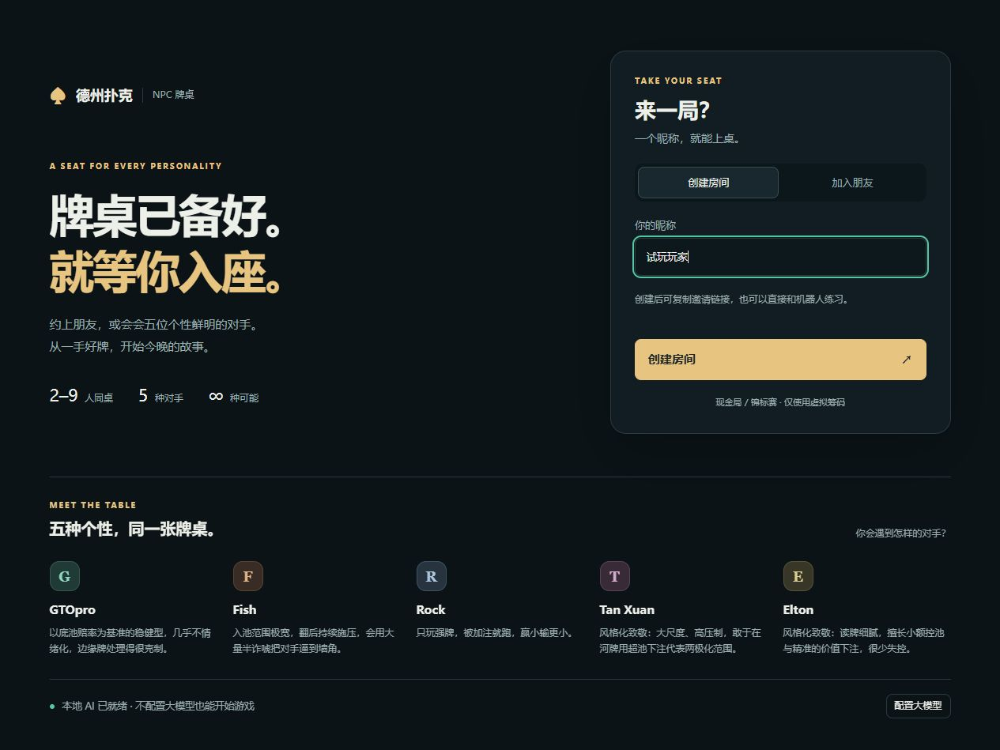
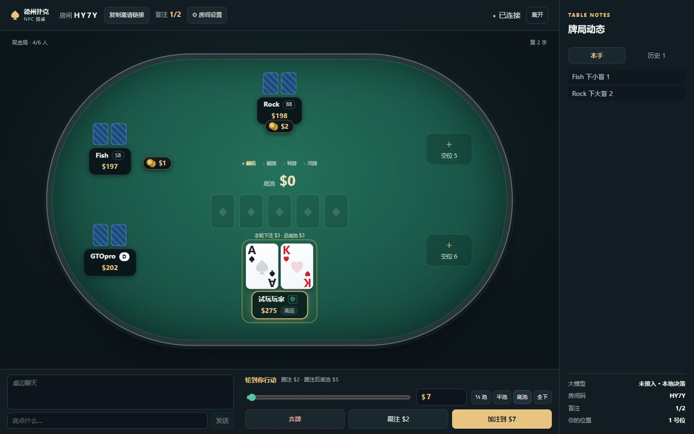

# Web 体验优化 · 2026-10-17

原版提交：`102cca0`。备份标签：`backup/pre-optimization-20261017`。
优化分支：`codex/table-experience`。`main` 保留原版。

## 本轮改动

- 大厅采用深绿、暖金配色，分开创建房间和加入朋友，集中展示五种对手。
- 空位默认收起买入和机器人选项，点击后展开；快速开桌自动入座并添加最多三位不同人格的机器人。
- 牌桌显示手数、阶段、本轮下注与总底池；行动区展示跟注价格、跟注后底池和倒计时，并增加三分之一底池快捷键。
- 修复窄窗口下牌桌高度塌缩、侧栏错位；窄屏操作区单独显示自己的手牌和剩余筹码。
- 底池下注按「补齐跟注后，对新底池下注指定比例」计算，加注目标同时计入自己本轮已投入的筹码；金额始终受合法范围约束。
- 修复倒计时先广播后设置的问题；其他玩家入座、调整默认买入等无关更新不再重置行动时钟。
- 对局中允许修改行动限时；拒绝修改盲注时不再部分写入其他设置。
- 修复创建房间后断线重连使用空房间号的问题，忽略旧连接事件，并在组件卸载时清理连接和重试。

本轮覆盖 Git 已跟踪的 Web 与服务端代码。小程序目录沿用原有忽略设置；没有修改 `.env` 或大模型密钥，也没有增加运行依赖。

## 验证

- `npm test`：166 项全部通过。
- `npm run typecheck`、`npm run build:web`、`git diff --check`：通过。
- 真实 WebSocket 冒烟对局：筹码净变化为零；13 次进行中快照，其他玩家底牌泄露零次。
- 浏览器实测创建房间、自选买入、快速开桌、设置保存、底池快捷金额、窄屏布局。
- 用临时本地代理模拟入座后网络断开：重连发送原房间号和已有令牌，恢复原座位及当前手牌。





## 回退

不满意时可以直接让 Codex「退回优化前」。原版仍在 `main`，优化内容保留在独立分支。当前分支没有未提交修改时，手动回退源码和前端构建的命令是：

```powershell
git switch main
npm run build:web
```

随后重启对应的游戏服务并刷新浏览器。`dist/web` 不由 Git 跟踪，因此切换分支之后需要重新构建，才能同时恢复界面。服务端牌局保存在内存中，重启服务会清空该进程的房间。

本轮本地预览使用 `http://127.0.0.1:8788` 和本地 AI；原有 8787 服务未停止。临时浏览器检查脚本放在已忽略的 `.chrome-check/optimization` 中。
