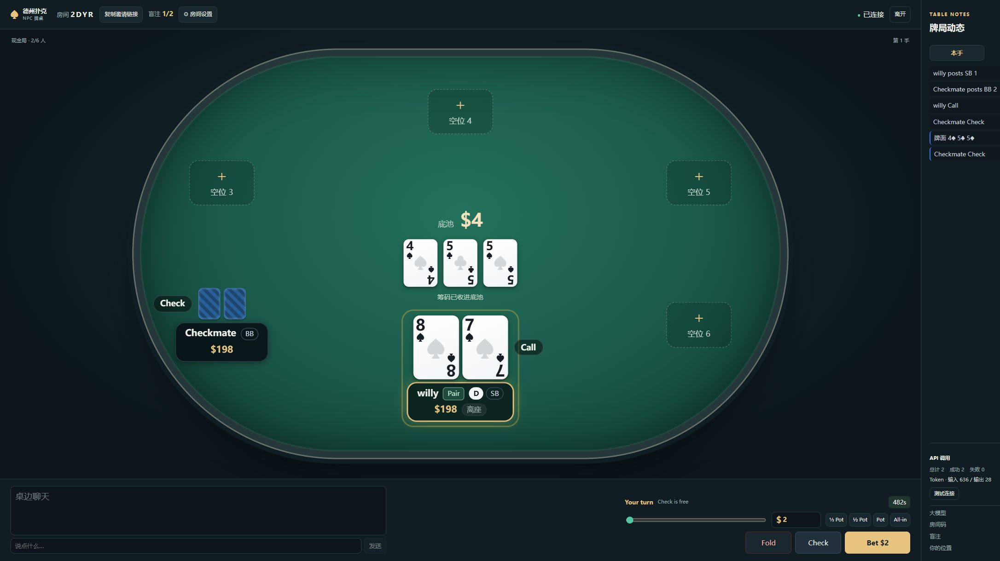

# 牌桌细化与 DeepSeek 诊断 · 2026-10-17

上一版提交：`a4adad6`；本轮继续在 `codex/table-experience` 上单独提交。

## 界面

- 移除牌桌中央的翻前、翻牌、转牌、河牌阶段提示。
- 行动按钮、下注快捷键、座位行动标签、弃牌与全下标记，以及行动日志采用英文。
- 行动区最大宽度 620px，桌面按钮常规最小宽度 100px，主行动按钮 142px；窄屏按可用空间排版。
- 自己的名字旁显示目前的最佳牌型：High card、Pair、Two pair、Triple、Straight、Flush、Full house、Four of a kind、Straight flush。翻前识别手牌对子，翻后使用底牌和当前公共牌评估最佳五张。
- 牌型由服务端计算，只发给对应玩家；不下发其他玩家的私有牌型。

## DeepSeek 调用失败的原因

诊断时，8788 旧预览服务记录了 3 次调用、3 次失败、0 token。最小请求在受限环境里返回 `EACCES`，同一密钥和接口在沙箱外返回 HTTP 200，说明问题来自预览服务的网络权限。

新版本地服务运行在 `http://127.0.0.1:8792`，使用现有 `.env` 配置和允许外网访问的启动环境。没有修改或提交用户的 API Key。

同时修复两项代码问题：

- 缓存的机器人曾捕获旧的大模型配置；现在每次行动读取当前配置，启用、更换、关闭接口都能对已有机器人生效。
- 过去只有合法动作回复才累计 token；现在收到接口用量即记录，即使后续动作校验失败也保留用量。

大厅和侧栏新增 API 请求数、成功数、失败数、输入与输出 token、最近失败原因，以及「测试连接」按钮。测试使用独立的合成请求，不携带当前牌局数据；它会产生一次真实请求和少量 token。

这些统计来自当前服务中接口返回的 usage，不是供应商账单。重启服务或更新模型配置后重新累计。常规小底池依旧使用本地策略，不保证每手都会调用大模型。

## 验证

- 172 项自动化测试、TypeScript 类型检查和生产构建通过。
- 回归测试覆盖配置切换、无效回复的 token 记录、权限错误脱敏、牌型随公共牌升级，以及其他玩家牌型隐藏。
- 浏览器实测：阶段提示为零；2280×1220 窗口下行动区 620px，三个按钮为 100px、100px、142px；翻牌后 High card 更新为 Pair。
- 真实 DeepSeek 连接测试和机器人面对全下的决策各成功一次：共 2 次成功、0 次失败，636 输入 / 28 输出 token。
- WebSocket 冒烟测试增加私有牌型泄露审计。

需要回退到上一版时，指定 `a4adad6` 即可；最初原版仍保留在 `main` 的 `102cca0`。切换源码后需重新构建前端并重启对应服务。
