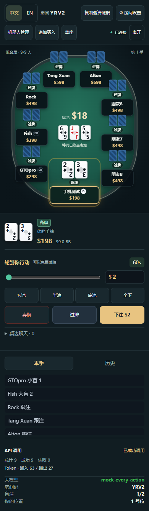
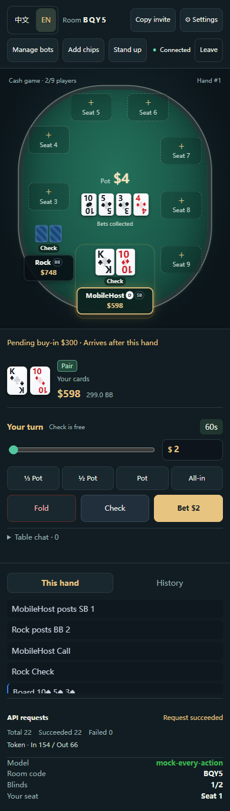
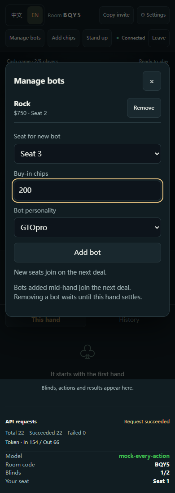
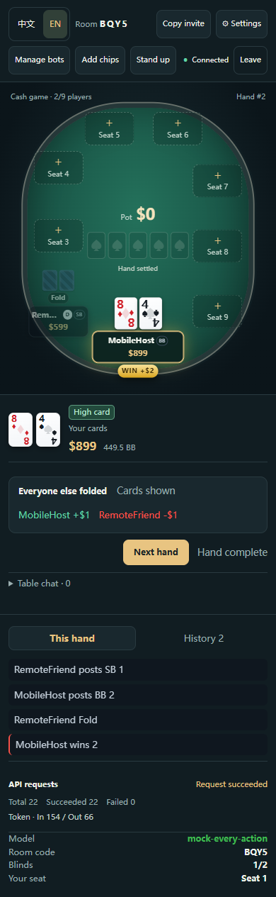

# 联机牌桌更新 · 2026-10-18

## 行为

1. 房主可以给每个新入座机器人填写买入金额，范围与玩家一致。机器人自动重新买入时沿用该机器人的买入金额。
2. 手机使用独立的竖向牌桌，满九人时公共牌与座位分开；下注金额显示在玩家名牌里。座位选择、机器人管理、追加买入均使用未缩放的表单，聊天默认折叠。
3. 配置模型后每次机器人行动都会请求模型，包括过牌、跟注和弃牌；取消每手两次的限制。接口超时、报错或返回非法动作时仍有本地策略兜底。机器人不发送聊天。
4. 大厅与牌桌均可切换中文 / EN，语言偏好保存在浏览器。行动、牌型、历史、房间设置、机器人管理和用量面板随之切换，不翻译昵称及玩家聊天。
5. 真人全部离座、只剩机器人时自动关闭房间并从服务器移除。主动离开由客户端明确通知服务器；所有真人断线时立即取消机器人定时器与在途请求，暂停牌局，60 秒内可重连，超时关桌。
6. 仅房主可增减机器人，服务器也检查权限。局中加入下一手发牌；局中移除等待结算，不能抽走已在底池中的筹码。房主离开后交给其他在线真人。
7. 其余玩家都弃牌后，赢家可以在下一手开始前点击「亮出底牌 / Show cards」。默认不公开；服务端只接受当前手赢家的请求。已公开的底牌写入该手历史，下一手清除公开状态。
8. 现金局有筹码时也能追加买入。局中提交显示为待到账，本手结算、历史归档完成后加入筹码，不改变当前全下、边池或净输赢。锦标赛继续禁止重新买入。

前后端协议一起更新；无需数据库迁移。服务器重启仍会清空内存牌局，部署请等正在进行的牌局结束。

## 验证

- 原问题复现：`node --test --test-isolation=none --test-name-pattern='last human standing' src/server/room.test.ts` 在修复前失败，最后一位真人离座后 `nextHandAtMs` 仍为 `6000`，预期 `null`。
- 修复后：`npm run typecheck`、`npm test`（192 项）、`npm run build:web`、`git diff --check` 通过。
- 真实生产模式 HTTP / WebSocket 回归包含在 `src/server/main.test.ts`：检查非房主管理被拒绝、买入排队及筹码守恒、亮牌的私密性、房主交接和房间移除。子进程明确禁用真实 API Key。
- Playwright 使用本机模拟 OpenAI 兼容接口，验证每次机器人行动对应一次模型请求、机器人不聊天、语言切换与刷新保存、双人自愿亮牌及最后真人离开后关桌。
- 视口宽度 320 / 390 / 430 / 844 / 1440 像素均无横向溢出。九人满桌实测五个机器人及三位模拟朋友，检查座位与公共牌区域不重叠。
- 浏览器验证使用模拟模型与虚拟筹码，没有调用真实模型。

## 界面

九人手机牌桌：

英文手机行动区：

房主管理：

自愿亮牌：

