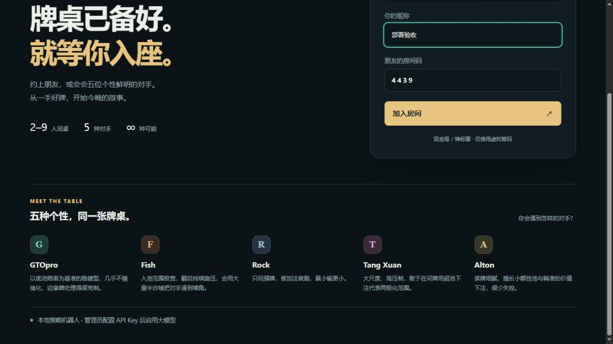

# 2026-10-17 静态部署故障修复

## 原因与复现

用户反馈公开站点不能创建游戏、只剩 GTOpro，并显示本地 AI。

只读探测 `https://dcpoker.awamyy.top`：首页返回 200，但 `/healthz`、`/api/personas`、`/api/llm`、`/api/config` 和 `/ws` 均返回 404。用户随后确认只上传了 `dist/web`，没有运行 Node 后端。旧前端在请求失败时用一个 GTOpro 兜底，并把未知模型状态显示成“本地 AI 已就绪”，造成额外误解。

本地静态站点夹具复现同一故障：只有 GTOpro，创建按钮持续“正在连接”。完整 Node 服务则所有接口和 WebSocket 正常。

## 修复

- 游戏 API 缺失、返回 HTML 或超时，明确显示“游戏服务未连接”，提供重新检查和部署诊断；不再伪造机器人名单或模型就绪状态。
- 首次连接失败最多自动重试两次，连接超时会关闭；恢复按钮并显示错误，也可取消连接。已加入房间的断线重连仍保留。
- 显示名 Tan Xuan → Tang Xuan、Elton → Alton；内部 persona ID 保持兼容，五位机器人均保留。
- 管理员在服务器 `.env` 配置一次 API Key，所有房间共用；生产环境仍禁止普通玩家修改全局密钥或执行连接测试。
- 新增根目录 `DEPLOY-FIX.md`，针对该子域名说明完整项目启动、反向代理及管理员配置。
- 部署验收脚本检查全部五个机器人，静态部署错误会直接说明缺少 Node 后端。

## 验证

- 179 项自动测试、类型检查、生产构建通过。
- 相同静态夹具：新版显示后端错误、不显示 GTOpro 假列表、不显示“本地 AI 已就绪”。
- 只阻断 WebSocket 的夹具：失败后恢复创建按钮、显示连接错误，不再无限等待。
- 完整生产服务：浏览器创建房间成功，五个机器人全部显示；真实双人 socket 完成一手牌，底牌隔离及筹码守恒检查通过。
- 线上 Nginx/进程配置需由持有服务器权限的部署者按 DEPLOY-FIX.md 修改；本地打包不等于线上已修复。真实 Key 未包含在发布包，也未为本次诊断调用付费模型。

本轮之前的版本为 `b9f147e`，备份标签 `backup/pre-static-fix-20261017`。可回退代码；服务重启会清空内存牌局。
